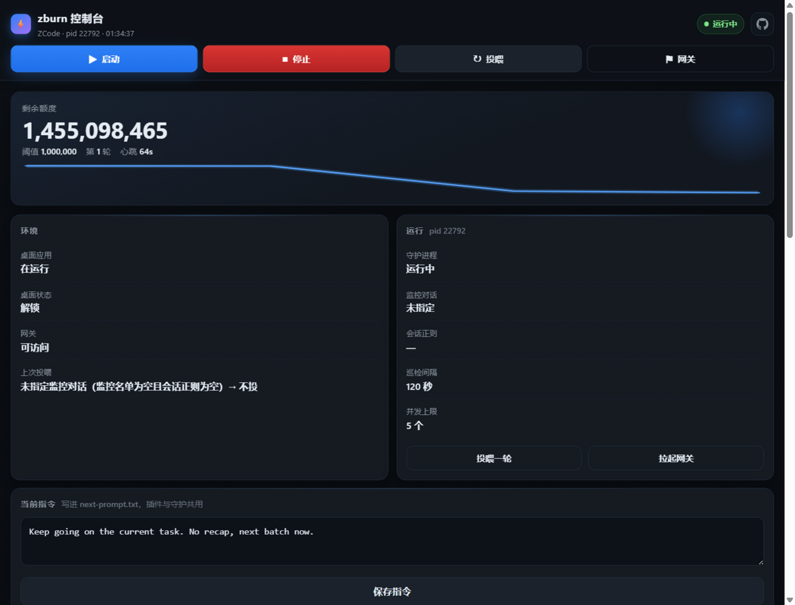
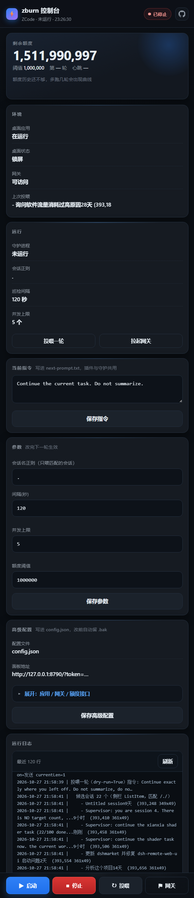

# zburn · 熄屏守护

**锁屏/熄屏状态下，持续驱动桌面 AI 应用干活**——不需要解锁、不需要前台焦点、不会把字打进密码框。
默认场景：让 ZCode 一直跑下去直到后端额度烧完；换个配置也能驱动别的桌面应用。

```
┌─────────────┐   探活/必要时启动(绝不重启)   ┌──────────────┐
│ zburn run   │ ───────────────────────────▶ │ 网关/后端进程 │
│ （守护循环） │ ◀─── 剩余额度（HTTP/命令）── │              │
└──────┬──────┘                              └──────────────┘
       │ UI Automation + WM_CHAR（不抢焦点）
       ▼
┌─────────────────────────────────────────────────────────┐
│ 桌面应用（ZCode）：会话列表 → 只找「指定/匹配」的会话 → 补一条续派 │
│ 正在出字(busy)/已排队(queued) 的会话自动跳过             │
└─────────────────────────────────────────────────────────┘
```

## 为什么不是 SendKeys

锁屏时 `SetForegroundWindow` 必然失败，`SendKeys` 会把字符送进**锁屏密码框**（真实事故风险）；
而 zburn 全程走 UI Automation 的 `ValuePattern / InvokePattern` + 目标窗口 `WM_CHAR`，
**不抢焦点、不点鼠标**，锁屏照常工作。

实测踩到的坑（都在代码里避开了，详见 [docs/熄屏原理.md](docs/熄屏原理.md)）：

| 现象 | 结论 |
|---|---|
| 快速连发 WM_CHAR 丢字 | 每字 20~25ms，每 6 字停一下 |
| 回车提交不稳定 | 改成 Invoke「发送」按钮，回车只做兜底 |
| 「移除待发送消息」「停止生成」名字里也含"发送/生成" | 发送按钮必须按正则**排除**它们，否则点错按钮 |
| **退格清不掉输入框内容**（WM_CHAR 0x08 / VK_BACK / Ctrl+A 全无效） | 不依赖清空：改成**内容比对 + 只补缺失后缀**；框里有别人的文本就跳过（exit 7） |
| WM_CHAR 只认 ASCII | 指令必须是英文，CJK 会被映射成乱码 |
| 锁屏久了 Chromium 关掉无障碍树（只剩 D3D 子窗） | 检测到就重启应用（这是唯一有效的恢复手段） |
| Electron 应用被 `ELECTRON_RUN_AS_NODE` 污染秒退 | 拉起前清掉这个环境变量 |

## 安装

无第三方依赖，Python 3.10+ 即可；脚本是 PowerShell（Windows 自带 5.1 或 pwsh 7）。

```powershell
git clone https://github.com/3366434156/zburn.git
cd zburn
copy config.example.json config.json     # 按需改路径/正则/额度接口
python zburn.py doctor --config config.json
```

## 快速上手

```powershell
# 0) 自检：应用在不在、无障碍树能不能用、网关通不通、额度读不读得到
python zburn.py doctor --config config.json

# 1) 看一眼输入框和发送按钮定位得对不对（只定位，不输入）
python zburn.py inject --config config.json --text "loop test" --dry-run

# 2) 投喂一轮（--dry-run 只列会话不投喂）
python zburn.py feed --config config.json --dry-run
python zburn.py feed --config config.json

# 3) 正式守护：每 120 秒巡检一次，直到额度烧完 / 出现 STOP 文件 / Ctrl+C
python zburn.py run --config config.json

# 4) 看门狗（心跳超过 420 秒没更新就重新拉起 run）
python zburn.py watchdog --config config.json
```

停止：在状态目录放一个 `STOP` 文件，或按 Ctrl+C，或点面板的「停止」。
`run` 在巡检间隙每 5 秒检查一次 STOP，所以最迟 5 秒内收工；面板停止会连带结束
正在投喂的 PowerShell 子进程（`taskkill /T`），不会出现「点了停止还在一个字一个字打字」。

## 双击启动（像 zcode2api 那样）

仓库根目录放了两个 `.bat`，Windows 下**双击即可**：

| 文件 | 作用 |
|---|---|
| `一键启动.bat` | 网关（挂了才拉起）→ 守护进程 → 看门狗 → 面板，并自动打开浏览器 |
| `启动网关.bat` | 只处理网关：探活，挂了就按 `config.gateway.start_command` 拉起来 |

`一键启动.bat` 等价于：

```powershell
python zburn.py up --config config.json
```

它会打印三个地址（本机 / 局域网 / 手机提示），token 没配时**自动生成**并存到 `.zburn/panel.token`，下次复用。
不想自动开浏览器加 `--no-browser`；不想起看门狗加 `--no-watchdog`。

## 可视化面板（手机 / 别的电脑都能开）



一条命令起来，一个页面管全部 —— 不用记命令：

```powershell
python zburn.py panel --config config.json                 # 只在本机看（默认 8790）
python zburn.py token                                      # 生成随机 token
python zburn.py panel --config config.json --host 0.0.0.0 --port 8790 --token <token>
#   手机浏览器: http://<这台机器的局域网IP>:8790/?token=<token>

python zburn.py up --config config.json --host 0.0.0.0 --token <token>   # 守护+看门狗+面板 一条全起
```

> 端口被别的程序占了（比如别的网关也在 8788），面板会**自动往后顺延**到第一个空闲端口，
> 并在启动时把真实地址打印出来 —— 不会因为端口冲突起不来，也不会去抢别人的端口。

| 区域 | 能干什么 |
|---|---|
| 状态卡 | 守护是否在跑 / 心跳多久前 / 第几轮 / 上次投喂结果 / 额度与阈值 / 应用·锁屏·网关状态 |
| 顶部操作条 | **启动守护** · **停止** · **投喂一轮** · **拉起网关**（吸顶常驻，不用滚到底部找按钮） |
| 当前指令 | 直接改下一轮要发的话（写进 next-prompt.txt，插件读同一份） |
| 会话监控 | 扫描侧栏对话 → 按项目分组列出、标出「当前」打开的对话 → 勾选要监控的 → 保存；名单常驻可见、可单独移除（写进 `feed.targets`，下一轮生效） |
| 参数 | 会话正则 · 窗口标题正则 · 巡检间隔 · 并发上限 · 额度阈值（改完下一轮生效） |
| 高级配置 | 应用进程名/exe · 网关健康地址/启动命令/工作目录 · 额度接口与管理密钥 · 发送按钮正则 · 面板监听与端口（写回 `config.json`，改前自动留 `.bak`） |
| 日志 | 最近 120 行，3 秒自动刷新 |
| 额度曲线 | 每轮额度落点的迷你折线 |

### 配置在哪改

三条路，随便挑一条：

1. **面板「参数」卡**：会话正则、间隔、并发、阈值、对话轮换轮数、压缩阈值、指令上限、钉死的模型，改完点保存，守护进程下一轮生效。
2. **面板「高级配置」卡**：应用/网关/额度接口/端口这些，展开填完点保存，直接写回 `config.json`（先备份 `.bak`）。正则写错、端口非法会被挡下来并提示，不会把配置写坏。
3. **直接编辑 `config.json`**：字段含义见 [docs/配置说明.md](docs/配置说明.md)，`config.example.json` 是带注释的模板。

`config.json` 会自动找：`--config` → 环境变量 `ZBURN_CONFIG` → 当前目录 → `zburn.py` 所在目录 →
`%LOCALAPPDATA%\zburn\`。都没有才用内置默认值（没有 agents、没有额度源），
`doctor`/`status` 第一行会打印这次实际读的是哪个文件。

手机上看就是这样：



安全：默认只监听 `127.0.0.1`；`--host 0.0.0.0` 时必须给 `--token`，否则非本机请求一律 401。
更稳的远程方式：Tailscale/ZeroTier 组内网，或 `ssh -L 8790:127.0.0.1:8790` 端口转发（面板不用对外开端口）。

## 三种跑法，按场景选

| 场景 | 用什么 | 说明 |
|---|---|---|
| 人在，想要「回合结束自动继续」 | **插件** `zburn.py plugin install` | 应用自己的 Stop 钩子，不用轮询，最省事；只在回合结束时触发 |
| 无人值守 / 锁屏 | **`zburn.py run`** | UIA 轮询投喂；能处理应用崩溃、无障碍树被关、网关挂掉 |
| 两个都要 | 插件 + run | 双保险：插件负责"下一回合"，run 负责"应用挂了/卡住" |

插件安装：

```powershell
python zburn.py plugin install
# 然后在你应用的 CLI 里启用并**重启会话**（钩子在会话启动时绑定）
# 开关文件：~/.zburn/continue.enabled（没有它钩子只写日志不干预）
```

## 多 Agent：让 dsh 监督 ZCode（新）

一个 worker 干活、一个 supervisor 定时醒来验收——不再只会往旧会话里灌 `Continue`：

```jsonc
"agents": [
  { "id": "zcode", "name": "ZCode", "role": "worker", "enabled": true },
  { "id": "dsh", "name": "dsh", "role": "supervisor", "enabled": false,
    "supervises": "zcode",
    "app": { "process_name": "DeepSeek Harness",
             "exe": "E:\\exe\\DeepSeek Harness\\DeepSeek Harness.exe",
             "start_args": ["--force-renderer-accessibility"],
             "strip_env": ["ELECTRON_RUN_AS_NODE"] },
    "feed": { "targets": ["zburn 监督"], "interval_seconds": 600 } }
],
"orchestrator": { "enabled": true, "supervisor": "dsh", "worker": "zcode" },
"new_chat": { "button_regex": "新建任务|新建对话|New chat", "project": "zburn" }
```

* **supervisor 看什么**：优先读 ZCode 本地会话库（`~/.zcode/cli/db/db.sqlite`）里
  监控对话的真实消息，导出到 `%LOCALAPPDATA%\zburn-bridge\context.txt`；
  读不到才退回 UIA 可见文本。
* **supervisor 怎么回话**：往同一个桥目录写 `handoff.json`
  （`{"action":"feed"|"new_chat","prompt":"..."}`）或 `handoff.txt`（纯文本 = feed）。
  zburn 下一轮取走，排进 worker 的待执行队列；worker busy 时保留，不会丢。
* **新对话**：`action=new_chat` 会点 ZCode 项目行的「新建任务」，输入首条指令，
  并把新对话自动加入动态监控名单——所以后续「继续」会喂到新会话，不会一直困在旧上下文。
* **dsh 必须带无障碍开关重启一次**（会打断正在跑的回合）：
  `python zburn.py restart-app --config config.json --agent dsh --yes`，然后在面板「多 Agent」卡点「启用」。

手动命令：`agents` / `newchat` / `handoff` / `supervise` / `snapshot`，详见
[docs/多Agent监督.md](docs/多Agent监督.md)。

## 换一个应用也能用

zburn 不认死 ZCode，只认「无障碍树里的控件形状」：

```powershell
# 1) 摸清控件：聊天输入框是面积最大的 Edit，发送/停止按钮叫什么名字
python zburn.py probe --config config.json --filter "Edit|Button"
pwsh -File scripts/probe-edits.ps1 -ProcessName Notepad

# 2) 改 config 里的三个东西：process_name / exe / 按钮与状态正则
```

配置里所有"应用相关"的都在 `app` 和 `uia` 两段：

```json
"app": {"process_name": "ZCode", "exe": "E:\\exe\\Zcode\\ZCode.exe", "strip_env": ["ELECTRON_RUN_AS_NODE"]},
"uia": {
  "send_button_regex": "发送|加入队列|Send",
  "busy_regex": "停止生成|Stop generating",
  "queued_regex": "移除待发送消息|Remove queued",
  "window_title_regex": "",
  "session_regex": ""
},
"feed": {"targets": ["Supervisor: zburn"]}
```

要喂哪些会话**必须显式指定**，两条路选一条（或都用）：

* `feed.targets`：监控名单，面板「会话监控」卡扫描侧栏后勾选生成，优先级最高。
  条目就是对话标题；侧栏里有同名对话时是「标题#序号」（`#2` = 同名组里第 2 条），
  所以重名对话也能只喂其中一条；
* `uia.session_regex`：会话名正则。

两个都为空就是**不投喂**（日志会说「未指定监控对话」）。名单里的对话改名了、
侧栏里找不到，同样**不投喂**并提示，不会退回全喂。以前默认 `.` 会把续派指令
灌进侧栏每一个对话，所以默认值改成了空。

`window_title_regex` 用在「同一个客户端开了多个窗口」的情况：按窗口标题挑一个，
避免把字打进另一个窗口。留空 = 第一个有主窗口的进程。

## 额度：三种来源

| provider | 说明 |
|---|---|
| `none` | 不看额度，永远不停（靠 STOP 文件/Ctrl+C 停） |
| `gateway_zcode2api` | 读 `GET /admin/api/accounts`（`Authorization: Bearer <admin_key>`），自动在 JSON 里找 `remaining/balance/left…` 求和 |
| `command` | 跑任意命令，输出里第一个 ≥4 位的整数就当剩余额度 |

```json
"quota": {
  "provider": "gateway_zcode2api",
  "url": "http://127.0.0.1:3000/admin/api/accounts",
  "admin_key": "zcode",
  "refresh_url": "http://127.0.0.1:3000/admin/api/accounts/refresh",
  "refresh_body": {"all": true},
  "refresh_every_seconds": 600,
  "stop_below": 1000000
}
```

低于 `stop_below` 自动收工；`refresh_every_seconds` 到点会请求后端刷新额度。

网关保活是**只探活、必要时启动，绝不重启**——重启正在跑的网关会让所有对话断流（"connection lost / turn failed"）。
这一条写死在 [scripts/ensure-gateway.ps1](scripts/ensure-gateway.ps1) 里。

## 命令一览

| 命令 | 作用 |
|---|---|
| `doctor` | 环境自检（应用/无障碍树/锁屏状态/网关/额度/模板） |
| `quota [--refresh]` | 读一次额度 |
| `accounts [--refresh] [--json]` | 按账号看额度明细：哪个号还剩、哪个烧完了、哪个还没刷过 |
| `queue [--next] [--list N] [--reset]` | 看任务队列派活进度、预览下一条会投喂什么、清进度 |
| `status [--follow]` | 看 status.json、心跳、最近日志 |
| `probe [--filter] [--json]` | 导出目标窗口无障碍树（换应用第一件事） |
| `inject --text "…" [--dry-run] [--no-enter]` | 直接往输入框投一条 |
| `feed [--dry-run] [--prompt "…"] [--agent id]` | 投喂一轮 |
| `run [--dry-run]` | 守护循环（多 agent 调度 / 保活 / 网关 / 额度 / 交接） |
| `agents` | 列出 agent、角色、监控数、轮次、模型状态、待执行交接 |
| `sessions [--agent id]` | 列出侧栏对话，标出「当前 / 名单内 / 匹配正则」（看它到底会喂谁） |
| `target --match 片段 \| --add X \| --remove X \| --clear` | 不开面板直接改监控名单 |
| `newchat --agent zcode --prompt "…"` | 新建对话并投递首条指令（`--dry-run` 只定位） |
| `handoff --action feed\|new_chat` | 手动写一份监督交接 |
| `handoff --list / --apply` | 看 / 执行桥里的交接 |
| `supervise [--wait 120]` | 立刻唤醒 supervisor 验收 |
| `snapshot [--agent zcode]` | 导出 worker 对话尾部（调试监督上下文） |
| `watchdog` | 心跳超时拉起 run |
| `restart-app [--agent id] [--yes]` | 带 `--force-renderer-accessibility` 重启目标应用（修「无障碍树为空」） |
| `panel` / `up` | 起可视化面板 / 一键全起（网关+守护+看门狗+面板） |
| `gateway` | 只探活，必要时按配置拉起网关（绝不重启） |
| `token` | 生成面板 token |
| `model [--agent id] [--want zcode2api] [--set]` | 看/校验/切换当前对话的模型（`auto` 路由会白烧额度，建议钉死） |
| `model --pin-sessions [--dry-run]` | **按会话**钉模型：ZCode 的模型跟会话走，后台会话可能一直跑在 `auto/` 上（界面上那个按钮只代表当前打开的那个对话）。这个命令把「名单 ∪ 正则」能喂到的会话逐个切过去、钉回 `model.want`，钉好的不碰 |
| `batch --queue q.json` | 队列驱动：投喂 → 等文件改动 → 跑验收命令 → 记账（失败重试、断点续跑） |
| `autopilot --queue q.json --target …` | 夜间总控：分片并发 + 进程自愈 + 应用/网关自愈 |
| `plugin install\|remove` | 安装/卸载自动继续插件 |

## 别把额度白烧掉（血泪版）

这些是实测踩出来的，配置里都已经有默认值：

| 开关 | 默认 | 为什么 |
|---|---|---|
| `prompt.max_chars` | **180** | WM_CHAR 打长了会丢字（实测 400 字符开始翻车）。长指令写进文件让模型自己读，指令只指路 |
| `feed.rotate_after_turns` | **3** | 一个对话跑满 3 轮就 `new_chat` 换新的。**同一个对话续 200 轮会把上下文滚成天文数字**：同样一句 `continue`，第 1 轮几千 token，第 200 轮几十万，而且模型越来越糊涂 |
| `feed.compact_at_tokens` | **300000** | 上下文压缩闸门：被监控会话滚过 30 万 token 就先投 `/compact` 压回去，压完自动恢复续派。轮换兜不住的老会话（「新建任务」按钮滚出可视区、正则一直命中旧对话）实测能滚到 **88 万 token——这时一句 `continue` 就是 88 万 input token**；上下文从 ZCode 会话库读（和界面「上下文容量」同源），库读不到时闸门自动失效、照常投喂 |
| `feed.interval_seconds` | 120（建议 300） | 每轮都要重发整段历史，喂得越密烧得越快；忙的时候本来就会跳过 |
| `agents[].model.want` | 如 `zcode2api` | 模型写 `auto` 会按账号池自动路由，可能一直用某几个号、把别的号的额度留着不用。**新对话不继承上次选的模型**，所以每次新建/轮换后都会复查 |
| `model.enforce` | **开** | 模型没钉住时这一轮不投喂（日志 `skip:model`）。停一分钟比烧错一整夜划算。**按会话判定**：模型是跟会话走的，界面上那个按钮只代表当前打开的那个对话——被投喂的后台会话实际跑在 `auto/` 上时，看按钮永远看不出来（实测 6 个被监控会话里 3 个在 auto 上，其中一个滚到 93 万 token 还在被喂 `continue`）。现在每轮从会话库 `model_usage.model_id` 逐会话核对，跑偏的那几个不喂也不压，用 `zburn model --pin-sessions` 钉回来 |
| `model.on_mismatch` | `stop` | **只认一个模型**：检测到别的模型（界面按钮或会话库里任一处不对）→ 先尝试切回；切不动就立刻停整条链（退出码 3，`status.state=error, reason=model`），不再「跳过这一轮继续跑」 |
| `queue` | 关 | 开了就按队列逐条派活（每条带题材 + 验收命令），不再喂 `continue`。**空指令是跑题的根源**：模型只会自己挑题材，越挑越像文玩静物 |
| `quota.stop_below` | 见配置 | 到阈值自动收工，别把最后一个号也烧空 |
| `window` | 关 | 只在 `23:00`-`09:00` 这类时段干活（支持跨午夜）。时段外 `run` 显示「暂停中 / 下次几点开始」，进段自动继续 |
| `quota.stop_action` | `exit` | `wait` = 额度不够时原地等，够了自动继续（夜里额度按天重置时用这个） |

看是不是在空转：

```powershell
python zburn.py status       # 第一行：额度速率（数据过期会直说，不会拿旧点冒充「近一小时」）
python zburn.py doctor       # 配置来源、指令上限、对话轮换、每个 agent 的当前模型
python zburn.py sessions     # 侧栏里到底哪些对话会被喂（一个「匹配正则」都没有 = 空转）
```

`status` 里如果速率很高但任务没推进，基本就是上下文膨胀或者在反复重做——先降频、先轮换。

## 状态与日志

都写在 `paths.state_dir`（默认 `.zburn/`）：

```
.zburn/status.json          当前状态（cycle / remaining / last_feed_summary / pid …）
.zburn/zburn.log            全量日志
.zburn/heartbeat            心跳时间戳（watchdog 看这个）
.zburn/quota-history.csv    额度历史（每轮一行）
.zburn/hook.log             插件钩子日志
.zburn/continue.enabled     插件开关（存在才续派）
.zburn/next-prompt.txt      当前要发的指令（人肉可读，可手改）
.zburn/agents/*.json        每个 agent 的最近状态（last_feed / last_result / pending …）
.zburn/agents/*.targets.json 新对话自动加入的动态监控名单
.zburn/handoffs/            已消费的监督交接归档
%LOCALAPPDATA%/zburn-bridge/ 监督桥（context/status/handoff，给 dsh 读写）
```

## 目录

```
zburn.py                    CLI 主程序（doctor/quota/status/probe/inject/feed/run/watchdog/plugin）
agents.py                   多 agent 配置归一化 / 动态监控名单 / 监督交接协议
zsession.py                 从 ZCode SQLite 提取真实会话（给 supervisor 看）
scripts/
  inject-uia.ps1            锁屏注入器（内容比对 + 只补后缀 + Invoke 提交）
  new-chat.ps1              新建对话并投递首条指令（点项目行的「新建任务」）
  feed-sessions.ps1         多会话批量投喂（busy/queued 自动跳过）
  uia-tree.ps1              无障碍树导出
  probe-edits.ps1           列出所有 Edit（定位真正的输入框）
  probe-clear.ps1           验证"清空是否可用"（本项目结论：不可用）
  clear-composer.ps1        尝试清理输入框残留（清不掉会明说）
  ensure-gateway.ps1        网关探活/必要时启动（不重启）
plugin/zcode-continue/      Stop 钩子插件（额度没烧完就自动续派）
config.example.json         配置样例
docs/                       原理 / 配置 / 排查 / 多 Agent 监督
```

## 已知限制

- **Windows only**：UIA + PostMessage 是 Win32 那套；mac/Linux 需要换 AXAPI / AT-SPI 实现。
- **只能投 ASCII**：中文指令会被丢弃（WM_CHAR 的硬限制），要发中文得换剪贴板 + 粘贴方案（锁屏下不可靠）。
  监督交接的 `prompt` 也必须是 ASCII；`context.txt` 可以是中文（走文件，不走 WM_CHAR）。
- **dsh 第一次接入要重启一次**：Electron 不带 `--force-renderer-accessibility` 时 UIA 读不到聊天区；
  `python zburn.py restart-app --agent dsh --yes` 会打断 dsh 正在跑的回合。
- **新对话要求项目的「新建任务」按钮在侧栏可见**：滚出可视区时 zburn 会拒绝点击并提示，
  不会点空后把字打进当前对话；`new_chat.allow_offscreen: true` 只给排障用。
- **退格无效**：输入框里有残留文本时 zburn 不会强行追加，而是跳过并报 `exit 7`。
  可以先试 `pwsh -File scripts/clear-composer.ps1`（它会试 `ValuePattern.SetValue`，ZCode 某些输入框可写）；
  新对话默认**不会**自动清空，避免把另一个任务正在用的草稿抹掉。
- 无头/锁屏环境下拿不到 GPU 加速的窗口内容，所以不做截图校验，只看控件状态。
- 无障碍树在长时间锁屏后可能被 Chromium 关闭，`run` 会自动重启应用（会打断正在生成的会话，权衡后选了"能继续跑"）。
  **应用必须带 `--force-renderer-accessibility` 启动**（已写进 `config.app.start_args`），否则锁屏久了 a11y 会被关掉、UIA 读到空树；
  已经开着但树是空的，用 `python zburn.py restart-app --config config.json` 带开关重启一次即可。

## License

MIT
