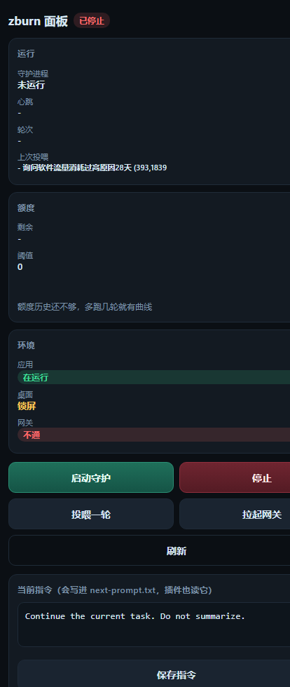

## 可视化面板（手机 / 别的电脑都能开）



一条命令起来，一个页面管全部 —— 不用记命令：

```powershell
python zburn.py panel --config config.json                 # 只在本机看
python zburn.py token                                      # 生成随机 token
python zburn.py panel --config config.json --host 0.0.0.0 --port 8788 --token <token>
#   手机浏览器: http://<这台机器的局域网IP>:8788/?token=<token>

python zburn.py up --config config.json --host 0.0.0.0 --token <token>   # 守护+看门狗+面板 一条全起
```

| 区域 | 能干什么 |
|---|---|
| 状态卡 | 守护是否在跑 / 心跳多久前 / 第几轮 / 上次投喂结果 / 额度与阈值 / 应用·锁屏·网关状态 |
| 大按钮 | **启动守护** · **停止** · **投喂一轮** · **拉起网关** · 刷新 |
| 当前指令 | 直接改下一轮要发的话（写进 next-prompt.txt，插件读同一份） |
| 参数 | 会话正则 · 巡检间隔 · 并发上限 · 额度阈值（改完下一轮生效） |
| 日志 | 最近 120 行，3 秒自动刷新 |
| 额度曲线 | 每轮额度落点的迷你柱状图 |

安全：默认只监听 `127.0.0.1`；`--host 0.0.0.0` 时必须给 `--token`，否则非本机请求一律 401。
更稳的远程方式：Tailscale/ZeroTier 组内网，或 `ssh -L 8788:127.0.0.1:8788` 端口转发（面板根本不用对外开端口）。

